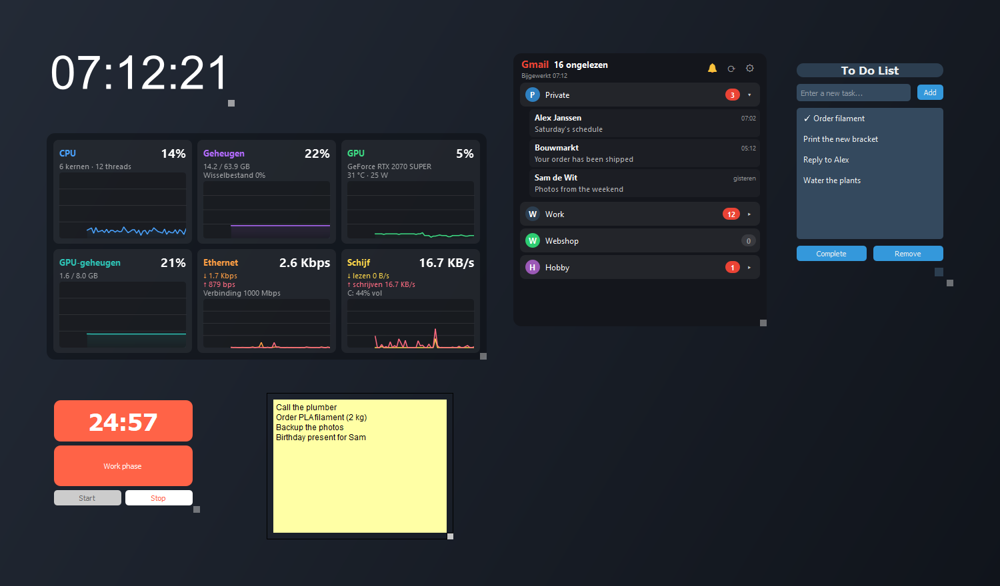

# Imolia Desktop Customizer


A powerful, open-source desktop customization tool for Windows, developed by Imolia Media. It puts small, always-visible widgets - clock, system graphs, your inbox, a to-do list, and more - on your desktop, and lets you write your own.



*(The repository is called `Imolia-Desktop-Customization-Tool`; the program itself is called **Imolia Desktop Customizer**.)*

## Features

- A transparent overlay across all your monitors that holds your widgets; clicks outside the widgets go straight to your desktop
- A widget system: drag, resize, configure, activate or deactivate widgets from one settings window
- Eleven widgets included (see below), and an easy way to write your own
- System tray icon: left-click shows/hides everything, right-click opens the menu
- Widget dependencies are installed from the settings window with one click

## Requirements

- Windows (developed and tested on Windows 11; Windows 10 should work too)
- To run the downloaded program: nothing else
- To run from source: Python 3.9 or newer (tested on 3.9 and 3.12)

## Installation

**Download a release** from the [Releases page](https://github.com/imoliamedia/Imolia-Desktop-Customization-Tool/releases), unzip it, keep the files together and run `Imolia Desktop Customizer.exe`. Check the release's version against the [CHANGELOG](CHANGELOG.md) to see which features it has.

**Or run from source:**

```
git clone https://github.com/imoliamedia/Imolia-Desktop-Customization-Tool.git
cd Imolia-Desktop-Customization-Tool
pip install -r requirements.txt
python main.py
```

Then right-click the tray icon, choose **Settings**, tick the widgets you want and click **Opslaan**. The [User Guide](docs/USER_GUIDE.md) explains everything step by step.

## Bundled widgets

| Widget | File | What it does |
|---|---|---|
| [Clock](widgets/clock_widget/README.md) | `clock_widget.py` | The time, with your choice of format, font and color |
| [Calculator](widgets/calculator/README.md) | `calculator.py` | A small calculator |
| [Modern To-Do](widgets/modern_todo_widget/README.md) | `modern_todo_widget.py` | A task list that is saved between sessions |
| [Pomodoro Timer](widgets/Pomodoro%20Productivity%20Timer%20Widget/README.md) | `Pomodoro Productivity Timer.py` | A work/break timer |
| [Quick Notes](widgets/Quick%20Notes%20Widget/README.md) | `Quick Notes.py` | A sticky note that saves itself |
| [System Monitor](widgets/system_monitor_widget/README.md) | `system_monitor_widget.py` | CPU, memory, disk and network as simple text |
| [System Overview](widgets/system_overview_widget/README.md) | `system_overview_widget.py` | Task Manager-style live graphs for CPU, memory, GPU, GPU memory, network and disk, all at once |
| [Google Calendar](widgets/google_calendar_widget/README.md) | `google_calendar_widget.py` | A calendar and your upcoming events from one or more Google Calendars |
| [Gmail Inbox](widgets/gmail_inbox_widget/README.md) | `gmail_inbox_widget.py` | Unread mail of several Gmail accounts at once; read, trash and mark mail in the widget |
| [LLM Chat](widgets/LLM%20Chat/README.md) | `LLMChat.py` | Ask OpenAI models questions (needs your own API key) |
| [ESP32 Web Dashboard](widgets/ESP32%20Web%20Dashboard%20Widget/README.md) | `esp32_web_dashboard.py` | The web page of a device on your network (an ESP32 project, a 3D printer's Mainsail/Fluidd page, ...) as a desktop widget |

More about the widgets folder, adding your own and contributing one: [widgets/README.md](widgets/README.md).

## Documentation

| Document | For |
|---|---|
| [User Guide](docs/USER_GUIDE.md) | Installing, using and managing the program |
| [Troubleshooting](docs/TROUBLESHOOTING.md) | When something does not work; where the log is |
| [Widget Development Guide](docs/WIDGET_DEVELOPMENT.md) | Writing your own widget |
| [Architecture](docs/ARCHITECTURE.md) | How the program is put together |
| [Releasing](docs/RELEASING.md) | Building, checking and publishing a release |
| [Testing](tests/README.md) | Running and writing tests |
| [Changelog](CHANGELOG.md) | What changed in which version |
| [Contributing](CONTRIBUTING.md), [Code of Conduct](CODE_OF_CONDUCT.md), [Security](SECURITY.md) | Taking part in the project |

## Building the Windows executable

The distributable build is produced from `Imolia Desktop Customizer.spec`, the authoritative, version-controlled build recipe (previous builds were made with ad-hoc, undocumented PyInstaller flags, which is why the resulting `.exe` used to behave inconsistently across machines).

```
pip install -r requirements.txt
pip install pyinstaller
pyinstaller --noconfirm "Imolia Desktop Customizer.spec"
```

This requires the `embedded_python` folder (a portable Python build, [see its README](embedded_python/README.md)) in the project root - it is bundled as-is via the spec's `datas`, not processed by PyInstaller.

The result is `dist/Imolia Desktop Customizer/`. **Distribute the entire folder**, not just the `.exe` file inside it. [docs/RELEASING.md](docs/RELEASING.md) lists the checks to do before you publish a build.

## Running the tests

```
python -m unittest discover tests
```

See [tests/README.md](tests/README.md).

## Contributing

We welcome contributions! Please see our [Contribution Guidelines](CONTRIBUTING.md). Want to write a widget? Start with the [Widget Development Guide](docs/WIDGET_DEVELOPMENT.md).

## License

This project is licensed under the GNU General Public License v3.0 - see the [LICENSE](LICENSE) file for details.

## About Imolia Media

Imolia Media is committed to creating innovative, user-friendly software solutions. Learn more about us at [www.imoliamedia.be](https://www.imoliamedia.be).
