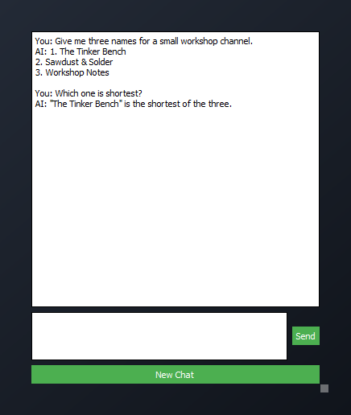

# LLM Chat Widget

A chat window on your desktop in which you can ask OpenAI's language models questions.

## Features

- Ask a question and get the model's answer, right on your desktop
- Choose the model in the settings (GPT-4o, GPT-4, GPT-3.5-Turbo and variants)
- Customizable colors (background, text, buttons), size and position
- **New Chat** clears the chat window

## Things to know first

- **Each question is sent on its own.** The widget does not send earlier messages along, so the model has **no memory** of the conversation: a follow-up like "and in French?" will not work. Put everything the model needs in each question.
- **Everything you type is sent to OpenAI.** Do not type anything you would not want to send to them.
- **You need your own OpenAI API key** (<https://platform.openai.com/api-keys>), and using the API costs money according to OpenAI's price list. The widget does not limit your usage.

## Your API key

- The key is stored **encrypted** (Windows DPAPI): only your Windows user can read it, and it is never written to a log. A key saved in plain text by an older version is converted automatically the next time the widget starts.
- Questions are sent in the background, so the desktop stays responsive while the AI is answering; the **Send** button is disabled until the answer arrives.
- The widget works with the `openai` version that ships with the program (0.27) as well as with newer versions (1.0 and up).

## Configuration

1. Right-click the tray icon of the Imolia Desktop Customizer and choose **Settings**.
2. Tick the LLM Chat widget (listed as **Llmchat**) and click **Opslaan**.
3. Open **Settings** again and click the settings button on its row. In the dialog:
   - Enter your **OpenAI API Key**
   - Select your **Model** (default: `gpt-3.5-turbo`)
   - Choose the **Background**, **Text** and **Button** colors
4. Click **Save**.

The settings (with the key encrypted) are stored in `llm_chat_widget_config.json` next to the widget file in your widgets folder.

## Usage

1. Type your question in the input field at the bottom.
2. Press `Enter` or click **Send**. (`Shift+Enter` starts a new line.)
3. The answer appears in the chat window above.
4. Click **New Chat** to clear the window.

## Supported models

The list in the settings contains `gpt-4o`, `gpt-4`, `gpt-4-0613`, `gpt-4-32k`, `gpt-4-32k-0613`, `gpt-3.5-turbo`, `gpt-3.5-turbo-16k`, `gpt-3.5-turbo-0613` and `gpt-3.5-turbo-16k-0613`. The list is fixed; models that OpenAI has retired will give an error in the chat window, and models that are newer than this list cannot be selected.

## Troubleshooting

- Errors from OpenAI (a wrong key, no access to the model, no credit) are shown in the chat window as `Error: ...`.
- If the widget does not appear, check that it is ticked and saved, and that the overlay is visible (left-click the tray icon).
- Technical details are in `%APPDATA%\Imolia Desktop Customizer\logs\app.log`. The widget logs only the *type* of an error, never your key or your questions.

See also the [Troubleshooting guide](../../docs/TROUBLESHOOTING.md).

## Requirements

- Imolia Desktop Customizer
- An OpenAI account and API key
- The `openai` Python package (version 0.27.0 or newer; installed from the Settings window if missing)

## Support

For support, please open an issue on our [GitHub repository](https://github.com/imoliamedia/Imolia-Desktop-Customization-Tool/issues).
