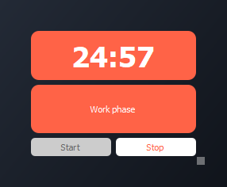

# Pomodoro Timer Widget

## Description

The Pomodoro Timer Widget is a productivity tool for the Imolia Desktop Customizer. It implements the Pomodoro Technique, a time management method developed by Francesco Cirillo in the late 1980s: work in focused intervals, traditionally 25 minutes, separated by short breaks.

## Features

- Customizable work and break durations
- A large `MM:SS` countdown with a status line (*Ready to start*, *Work phase*, *Break phase*, *Timer stopped*)
- Automatic switching between work and break phases, over and over until you stop it
- Customizable color

The widget does **not** play a sound or show a notification when a phase ends; look at the status line.

## Usage

1. Right-click the tray icon of the Imolia Desktop Customizer, choose **Settings**, tick **Pomodoro Productivity Timer** and click **Opslaan**.
2. Click **Start** to begin a work phase.
3. The timer counts down and switches between work and break phases by itself.
4. Click **Stop** to stop the timer. **Stop does not pause:** the next **Start** begins a new work phase with the full time again.

## Configuration

1. Open **Settings** again and click the settings button on the widget's row.
2. In the dialog you can change:
   - **Work duration (minutes)** - 1 to 60, default 25
   - **Break duration (minutes)** - 1 to 30, default 5
   - **Color**

The settings are stored in `pomodoro_timer_config.json` next to the widget file in your widgets folder (`Documents\Imolia Desktop Customizer Widgets`). Delete that file to reset the widget.

## Troubleshooting

If the widget does not appear or does not work correctly:

1. Check that the widget is ticked and saved in the Settings window.
2. Left-click the tray icon: it shows/hides the whole overlay.
3. Restart the Imolia Desktop Customizer.
4. Look for error messages in `%APPDATA%\Imolia Desktop Customizer\logs\app.log`.

See also the [Troubleshooting guide](../../docs/TROUBLESHOOTING.md).

## Contributing

If you'd like to contribute to this widget, please follow the [contribution guidelines](../../CONTRIBUTING.md).

## License

This widget is released under the GNU General Public License v3.0, in line with the project's license.

## Support

For support, please open an issue in the [GitHub repository](https://github.com/imoliamedia/Imolia-Desktop-Customization-Tool/issues).
