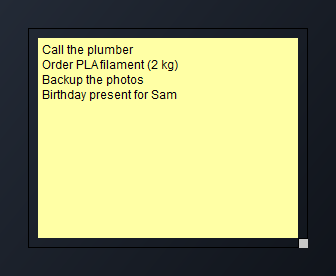

# Quick Notes Widget

## Description

The Quick Notes Widget is a sticky note for your desktop: jot down and read notes without opening a separate application.

## Features

- Draggable and resizable widget
- Real-time text editing
- Automatic saving: every change you type is saved, and the note is also saved every 30 seconds
- Customizable appearance (background color, text color, font and font size)
- Your note and the widget's settings are kept between sessions

## Usage

1. Right-click the tray icon of the Imolia Desktop Customizer, choose **Settings**, tick **Quick Notes** and click **Opslaan**.
2. Click in the widget and start typing.
3. Drag the widget to move it.
4. Drag the small grey square in its bottom-right corner to resize it.

## Customization

1. Open **Settings** again and click the settings button on the widget's row.
2. In the dialog you can:
   - Change the background color
   - Change the text color
   - Choose a different font and font size
3. Click **Save**.

## Configuration and your data

Everything is stored in one JSON file, `quick_notes_widget_config.json`, next to the widget file in your widgets folder (`Documents\Imolia Desktop Customizer Widgets`). It contains:

- Background color and text color
- Font family and size
- Widget size and position
- **The text of your note**

Use the settings dialog to change settings rather than editing the file by hand. The note is stored as plain text, so do not keep secrets in it.

## Troubleshooting

If you encounter any issues:

1. Check that the widget is ticked and saved in the Settings window.
2. Left-click the tray icon: it shows/hides the whole overlay.
3. Look for error messages in `%APPDATA%\Imolia Desktop Customizer\logs\app.log`.
4. As a last resort, delete `quick_notes_widget_config.json` to reset the widget - **this also deletes your note**.

See also the [Troubleshooting guide](../../docs/TROUBLESHOOTING.md).

## Contributing

Feel free to fork this widget and make your own modifications. If you develop improvements that you think would benefit other users, consider submitting a pull request, see the [contribution guidelines](../../CONTRIBUTING.md).

## License

This widget is released under the GNU General Public License v3.0, in line with the project's license.

## Support

For support, please open an issue on our [GitHub repository](https://github.com/imoliamedia/Imolia-Desktop-Customization-Tool/issues).
