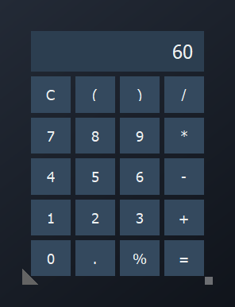

# Calculator Widget

A small calculator for your desktop.

## Features

- The four basic operations (`+ - * /`), decimals, brackets `( )` and a percent key `%` (which divides the current value by 100)
- Use the buttons or your keyboard (see below)
- Customizable colors for the background, the text and the buttons
- Resizable, with a separate handle for moving it
- Settings are remembered between sessions

## Usage

1. Right-click the tray icon of the Imolia Desktop Customizer, choose **Settings**, tick **Calculator** and click **Opslaan**.
2. Click the buttons to calculate. With the widget focused you can also type:

| Key | Action |
|---|---|
| Digits, `+ - * / . ( ) %` | Enter them |
| `Enter` | Calculate (`=`) |
| `Backspace` | Delete the last character |
| `Esc` | Clear (`C`) |

3. Move the widget with the handle in its **bottom-left** corner (the buttons themselves do not move it).
4. Resize it with the small grey square in the **bottom-right** corner.

## Customization

1. Open **Settings** again and click the settings button on the Calculator's row.
2. Use the color buttons to choose the **Background**, **Text** and **Button** colors.
3. Click **Save**.

## Configuration

The settings are saved automatically to `calculator_widget_config.json`, next to the widget file in your widgets folder (`Documents\Imolia Desktop Customizer Widgets`). Delete that file to reset the widget.

## Troubleshooting

1. Check that the widget is ticked and saved in the Settings window.
2. Left-click the tray icon: it shows/hides the whole overlay.
3. Look for error messages in `%APPDATA%\Imolia Desktop Customizer\logs\app.log`.
4. Make sure you are allowed to write to the widgets folder (the widget saves its settings there).

See also the [Troubleshooting guide](../../docs/TROUBLESHOOTING.md). If problems persist, please open an issue on our [GitHub repository](https://github.com/imoliamedia/Imolia-Desktop-Customization-Tool/issues).
