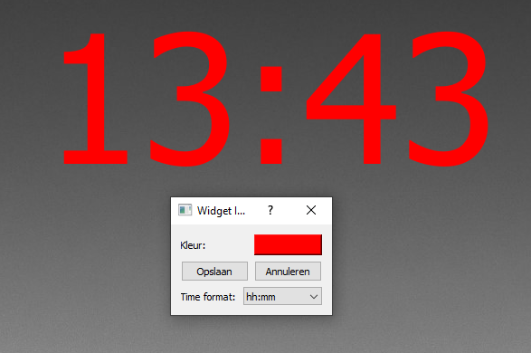

# Clock Widget

The Clock Widget displays the current time on your desktop.

## Features

- Shows the current time, updated every second
- Three time formats: `hh:mm`, `hh:mm:ss` (the default) and `hh:mm:ss ap` (12-hour clock with AM/PM)
- Adjustable text color, font family and font style (Normal, Bold, Italic, Bold Italic)
- Resizable: the text is 70% of the widget's height, so a taller widget shows a bigger clock

## Configuration

1. Right-click the tray icon of the Imolia Desktop Customizer and choose **Settings**.
2. Tick **Clock Widget** and click **Opslaan**.
3. Open **Settings** again and click the settings button on the Clock Widget's row. You can change:
   - Time format
   - Text color
   - Font family
   - Font style

The widget's settings are stored in `clock_widget_config.json` next to the widget file in your widgets folder.

## Usage Tips

- Drag the widget to move it around your desktop.
- Drag the small grey square in its bottom-right corner to resize it (and so change the size of the clock).

## Troubleshooting

If the widget is not displaying correctly:

1. Check that the widget is ticked and saved in the Settings window.
2. Left-click the tray icon: it shows/hides the whole overlay.
3. Restart the application.
4. Look for error messages in `%APPDATA%\Imolia Desktop Customizer\logs\app.log`.

See also the [Troubleshooting guide](../../docs/TROUBLESHOOTING.md). For further assistance, please open an issue on our [GitHub repository](https://github.com/imoliamedia/Imolia-Desktop-Customization-Tool/issues).
