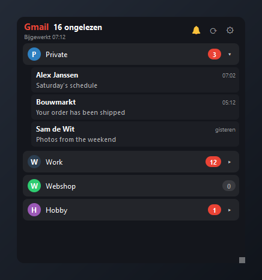
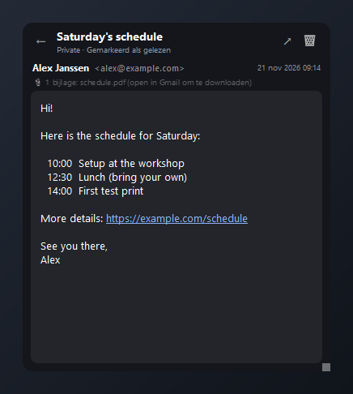

# Gmail Inbox Widget

Shows the unread mail of **several Gmail addresses at once**, checks for new mail every X minutes, and lets you read, trash and mark mail right in the widget.

*(The screenshots use made-up demo accounts and mail.)*

## Features

- One row per account with an unread counter
- Give each account a **display name** (for example "Private", "Work"): the widget then shows only that name and never the e-mail address, so visitors cannot read your addresses off the screen. Without a name, the address is shown
- Click an account to open its Gmail in your default browser (it opens the right account via `authuser`)
- Click the arrow next to the counter to list the newest unread messages (sender, subject, time)
- Click a message to **read it right in the widget** - no browser window pops up (see [Reading a mail](#reading-a-mail))
- Hover a message to **mark it as read** (✓) or **move it to the trash** (🗑 - this happens immediately without asking; the mail stays in Gmail's Trash for 30 days)
- New mail: the account row flashes for 15 seconds and a sound plays. Pick the sound yourself: any of the Windows sounds, or your own `.wav` file (the settings play a preview when you choose one)
- **Do not disturb**: the bell button (🔔) in the widget header silences the sound and the flashing. Counters and lists keep updating. The setting is remembered until you click the bell again (🔕 = silent)
- Accounts that cannot be checked show a red `!`; hover it to see why
- Passwords are stored encrypted with Windows DPAPI - only your Windows user on this PC can read them

## Setting up an account

Gmail does not accept your normal password in other programs, so every account needs an **app password**:

1. Turn on 2-Step Verification for the Google account (if it is not on already).
2. Go to <https://myaccount.google.com/apppasswords> and create an app password (name it for example "Imolia widget"). Google shows 16 characters; spaces do not matter.
3. Right-click the tray icon of the Imolia Desktop Customizer, choose **Settings**, tick **Gmail Inbox Widget** and click **Opslaan**. Open **Settings** again and click the settings button on the widget's row (or click the ⚙ in the widget's header). Click **Toevoegen…** (Add), enter the address, a display name and the app password, and press **Testen** (Test) to check it. Use **Bewerken…** (Edit) later to change the name or the app password (leave the password empty to keep it).

Repeat for each address. App passwords are not available for accounts with Advanced Protection, or when a Google Workspace admin has disabled them.

## Reading a mail

Click a message in the list and the list is replaced by the mail: sender, date, subject and the text, with a scrollbar. Buttons at the top: **←** back to the list, **🗑** move to the trash, **↗** open this conversation in Gmail (browser), **✓** mark as read (only shown when the mail is not read yet) and **Aa** to switch between the formatted and the text-only version (only when the mail has both).

- The mail is fetched without marking it as read; the widget then marks it as read (like Gmail does when you open a mail), so it leaves the unread list. It stays in your inbox and is still readable online. Turn off *"Mail als gelezen markeren zodra ik hem open"* in the settings if you would rather decide yourself with **✓**.
- Mails with formatting (newsletters, ads) are shown in a simplified way. **Images are never loaded**, which also blocks tracking pixels; scripts, frames and forms are removed. Use **↗** to see a mail exactly as intended.
- Hover a link to see where it really goes; clicking it opens your default browser (only `http`, `https` and `mailto` links work).
- Attachments are listed by name but not downloaded; use **↗** for those.
- Very large mails (over about 2 MB) are cut off, with a notice.
- Make the widget bigger for more comfortable reading.

## Settings

- **Gmail-accounts**: address, display name, app password
- Check every ... minutes (1-120)
- Number of unread messages shown per account (1-20)
- Mark mail as read when I open it (on by default)
- Sound on new mail: on/off, and which sound (a Windows sound or your own `.wav`)
- Background opacity and text color

The settings are stored in `gmail_inbox_widget_config.json` next to the widget file in your widgets folder, with the passwords encrypted. Do not share that file.

## Notes

- Checking for new mail only *reads* the inbox; it never marks anything as read. A mail counts as read when you open it in the widget (you can turn that off in the settings).
- Moving to the trash is reversible: the message ends up in Gmail's Trash folder.
- Use the mouse wheel to scroll when the list is longer than the widget.
- The widget talks to `imap.gmail.com` directly. Nothing is sent anywhere else.
- A packaged program needs the Python modules `imaplib` (and `html.parser` for formatted mails, without it they are shown as plain text). If the program is older than the widget, the account rows show a red `!` explaining that.

## Troubleshooting

- *"Inloggen mislukt"*: the app password is wrong or was revoked. Create a new one and use **Bewerken…**.
- *"Geen verbinding met Gmail"*: no internet, or a firewall blocks `imap.gmail.com` on port 993.
- *"Wachtwoord kan niet worden gelezen"*: passwords are encrypted per Windows user and PC; enter the app password again.
- Look for details in `%APPDATA%\Imolia Desktop Customizer\logs\app.log`, and see the [Troubleshooting guide](../../docs/TROUBLESHOOTING.md).
