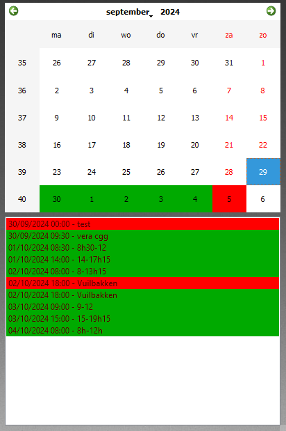

# Google Calendar Widget

This widget shows a calendar and the events of one or more Google Calendars (or any other calendar with an iCal address) on your desktop.

## Features

- A month calendar with the days that have events marked in the calendar's color
- A list of upcoming events; click a day to see the events of that day
- Events from several calendars at once, each in its own color
- Configurable date format and number of events shown
- Customizable widget colors
- A **Agenda verversen** button to refresh right now

## Getting the iCal address of a calendar

The widget reads a calendar through its private iCal address:

1. Open Google Calendar in your browser and go to the settings of the calendar you want.
2. Find the section **Integrate calendar** (*Integratie*).
3. Copy the **Secret address in iCal format**. It ends in `.ics`.

> **Treat this address like a password.** Anyone who has it can read that calendar. It is stored as plain text in the widget's config file (see below). If it leaks, reset the secret address in Google Calendar and enter the new one.

## Configuration

1. Right-click the tray icon of the Imolia Desktop Customizer and choose **Settings**.
2. Tick **Google Calendar Widget** and click **Opslaan**.
3. Open **Settings** again and click the settings button on its row. The dialog (in Dutch) has:
   - **Kalender URLs** - add an iCal address with **Voeg Kalender URL toe**; each calendar can get its own color
   - **Update interval** - 1 to 60 minutes. **Anything above 5 minutes is currently capped to 5 minutes internally.**
   - **Aantal events om te tonen** - the maximum number of events in the list (1-20)
   - **Datumformaat** - `dd/mm/yyyy`, `mm/dd/yyyy` or `yyyy-mm-dd`
   - **Kleuren** - the colors of the widget and the calendar
   Use **Opslaan** in the dialog to keep your changes.

The settings, including your iCal addresses, are stored in `google_calendar_widget_config.json` next to the widget file in your widgets folder.

## How it works

The calendars are downloaded **in the background**, so your desktop never waits for a slow connection. The widget keeps the events it already has; if a refresh fails (for example because you are offline) you keep seeing the last events, and it tries again at the next update.

## Usage

- Click a date in the calendar to see the events of that day
- Click today's date to see the upcoming events
- Events are color-coded per calendar

## Troubleshooting

If you encounter any issues:

1. Make sure your iCal addresses are correct and still valid (copy them again from Google Calendar)
2. Check your internet connection
3. Click **Agenda verversen**
4. Look for error messages in `%APPDATA%\Imolia Desktop Customizer\logs\app.log`

See also the [Troubleshooting guide](../../docs/TROUBLESHOOTING.md).

The extra packages this widget needs (`icalendar`, `recurring_ical_events`, `requests`) are included in the packaged program; when you run from source they are installed by `pip install -r requirements.txt`.

## Support

For support, please open an issue on the [GitHub repository](https://github.com/imoliamedia/Imolia-Desktop-Customization-Tool/issues) or contact info@imoliamedia.be.

## License

This widget is part of the Imolia Desktop Customizer and is licensed under the GNU General Public License v3.0.
