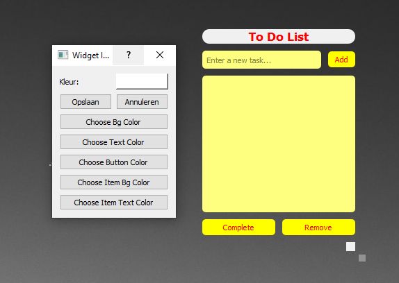

# Modern To-Do Widget

The Modern To-Do Widget is a sleek, user-friendly task list for your desktop.

## Features

- Add, edit and remove tasks
- Mark tasks as complete (they get a ✓ and are shown in the button color)
- Your tasks are saved between sessions
- Customizable color scheme
- Resizable widget

## Usage Tips

- Type a task in the input field and click **Add**
- Double-click a task to edit its text
- Select a task and click **Complete** to mark it as done
- Select a task and click **Remove** to delete it
- Drag the widget to move it around your desktop
- Drag the small grey square in its bottom-right corner to resize it

## Configuration

1. Right-click the tray icon of the Imolia Desktop Customizer and choose **Settings**.
2. Tick **Modern Todo Widget** and click **Opslaan**.
3. Open **Settings** again and click the settings button on its row. You can change:
   - Background color
   - Text color
   - Button color
   - Item background color
   - Item text color

## Where your data is stored

Both files are in your widgets folder (`Documents\Imolia Desktop Customizer Widgets`), next to the widget:

- `modern_todo_widget_tasks.json` - your tasks
- `modern_todo_widget_config.json` - colors, size and position

Delete `modern_todo_widget_tasks.json` to empty the list.

## Troubleshooting

If the widget is not displaying correctly:

1. Check that the widget is ticked and saved in the Settings window.
2. Left-click the tray icon: it shows/hides the whole overlay.
3. Restart the application.
4. Look for error messages in `%APPDATA%\Imolia Desktop Customizer\logs\app.log`.

See also the [Troubleshooting guide](../../docs/TROUBLESHOOTING.md). For further assistance, please open an issue on our [GitHub repository](https://github.com/imoliamedia/Imolia-Desktop-Customization-Tool/issues).
