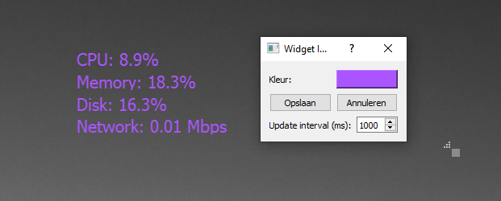

# System Monitor Widget

The System Monitor Widget shows real-time information about your PC as simple text on your desktop. For graphs of CPU, memory, GPU, network and disk all at once, see the [System Overview widget](../system_overview_widget/README.md).

## Features

Four lines, refreshed automatically:

- **CPU** - total usage in %
- **Memory** - RAM in use in %
- **Disk** - how full your system drive (usually `C:`) is, in %
- **Network** - current traffic in Mbps (download and upload added together)

Plus a customizable update interval, an adjustable text color and a resizable widget.

## Configuration

1. Right-click the tray icon of the Imolia Desktop Customizer and choose **Settings**.
2. Tick **System Monitor Widget** and click **Opslaan**.
3. Open **Settings** again and click the settings button on its row. You can change:
   - **Update interval (ms)** - how often the numbers refresh (100 - 10000 ms, default 1000 ms)
   - **Tekstkleur** - the text color

The settings are stored in `system_monitor_widget_config.json` next to the widget file in your widgets folder.

## Usage Tips

- Drag the widget to move it around your desktop
- Drag the small grey square in its bottom-right corner to resize it (the text grows with the widget)
- A longer update interval uses (slightly) fewer resources

## Troubleshooting

If the widget is not displaying correctly or shows strange numbers:

1. Check that the widget is ticked and saved in the Settings window.
2. Left-click the tray icon: it shows/hides the whole overlay.
3. Restart the application.
4. Look for error messages in `%APPDATA%\Imolia Desktop Customizer\logs\app.log`.

See also the [Troubleshooting guide](../../docs/TROUBLESHOOTING.md). For further assistance, please open an issue on our [GitHub repository](https://github.com/imoliamedia/Imolia-Desktop-Customization-Tool/issues).
