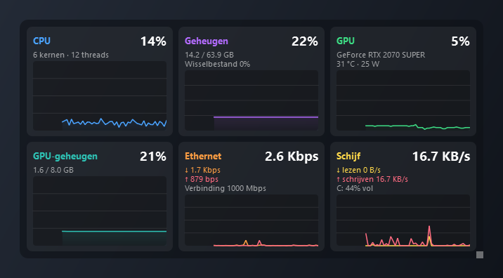

# System Overview Widget

A Task Manager-style dashboard for your desktop: CPU, memory, GPU, GPU memory, network and disk are all visible at once, each with its own live graph. Task Manager only shows one graph at a time - this widget shows the whole PC at a glance.

## Features

- **CPU** - usage graph, core/thread count
- **Memory** - RAM usage graph, used/total, page file usage
- **GPU** - usage graph, GPU temperature and power draw (NVIDIA)
- **GPU memory** - VRAM usage graph
- **Network** - download and upload graph (in Mbps) for your active physical adapter (Ethernet or Wi-Fi; virtual adapters such as Hyper-V/VMware are ignored), plus the link speed
- **Disk** - read/write throughput graph and how full the system drive is
- Temperatures turn orange from 75 °C and red from 85 °C
- Choose which panels to show, how many columns, the length of the graph history, the refresh rate, the text color and the background opacity
- Resizable and draggable; the measurements run in a background thread so the desktop never stutters
- Nothing leaves your PC: the widget only reads local information

## Requirements and limits

- **GPU data requires an NVIDIA card** with the driver installed (the widget uses `nvidia-smi`, which ships with the driver). Without it the GPU panels show "n.v.t." (not available). AMD/Intel GPUs are not supported yet.
- **CPU temperature** is not exposed by Windows to normal programs, so by default no CPU temperature is shown. If [LibreHardwareMonitor](https://github.com/LibreHardwareMonitor/LibreHardwareMonitor) (or OpenHardwareMonitor) is running - often as administrator - the widget picks up the CPU temperature from it automatically and shows it in the CPU panel.

## Configuration

1. Right-click the tray icon of the Imolia Desktop Customizer and choose **Settings**.
2. Tick **System Overview Widget** and click **Opslaan**.
3. Open **Settings** again and click the settings button on its row. You can change:
   - Refresh interval (0.5 - 10 s) and graph history (number of data points)
   - Which panels are shown, and the number of columns
   - Background opacity and text color

The settings are stored in `system_overview_widget_config.json` next to the widget file in your widgets folder.

## Usage Tips

- Drag the widget to move it; drag the small grey square in the bottom-right corner to resize it
- With fewer panels or a wider widget, use more columns; with a tall, narrow widget use 1-2 columns
- If the last row isn't full, its panels are stretched to fill the width
- A longer graph history (for example 120-300 points) shows a longer period at a glance

## Troubleshooting

- *GPU shows "n.v.t."*: check that running `nvidia-smi` in a terminal works.
- *No Ethernet/Wi-Fi traffic shown*: the widget only counts adapters that are up and not recognised as virtual. A VPN adapter is ignored on purpose; its traffic is already counted on the physical adapter.
- Look for error messages in `%APPDATA%\Imolia Desktop Customizer\logs\app.log`, and see the [Troubleshooting guide](../../docs/TROUBLESHOOTING.md).
